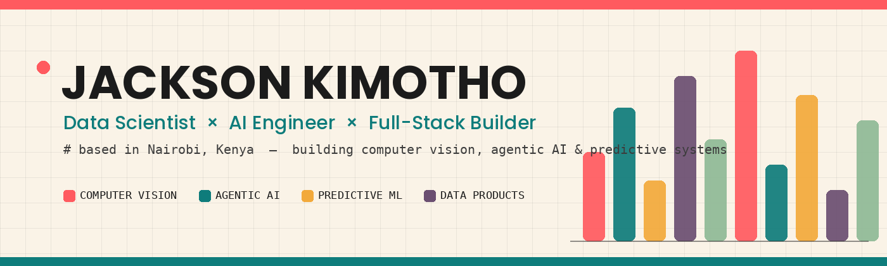

# Jackson Kimotho

### Data Scientist · AI/ML Engineer · Software Developer

**I turn data, machine learning and software into systems people can actually use.**

---

## About

I’m a Nairobi-based data and software practitioner with a background in **Data Science at KCA University**. My work sits at the intersection of data analysis, applied machine learning, AI engineering and full-stack development.

I enjoy taking a problem from its messy first version to a working product: understanding the data, choosing a sensible approach, building the backend and interface, and being honest about what the system can—and cannot—do.

My interests include:

- **Data science & analytics** — data preparation, exploratory analysis, statistical thinking, visualization and decision support.
- **Machine learning** — predictive modelling, evaluation, forecasting and practical model deployment.
- **Applied AI** — LLM-powered workflows, AI assistants, model integrations and automation.
- **Computer vision** — detection, tracking and extracting useful signals from images and video.
- **Software engineering** — APIs, databases and usable web applications that bring the intelligence into production.

I’m particularly interested in building useful technology for real-world problems in Africa and beyond.

## Selected work

A selection of public projects that show the problems I enjoy working on. Each project links to its own repository for implementation details, setup instructions and current limitations.

<table>
<tr>
<td width="50%" valign="top">

### [ParkWise AI](https://github.com/Jack-ki1/PARK_WISE_AI)

**Computer vision · Smart mobility**

A video-driven parking intelligence system. It processes parking footage, detects and tracks vehicles, evaluates configured parking bays and presents measured results in a web dashboard.

Python · FastAPI · YOLO · OpenCV · Next.js

</td>
<td width="50%" valign="top">

### [DASHBOARD AI](https://github.com/Jack-ki1/DASHBOARD_AI_01)

**AI product · Data visualization**

An AI-assisted dashboard builder. Users can start with a prompt, dataset or template, then refine dashboards in a visual studio and publish shareable views.

React · TypeScript · Node.js · Express · SQLite

</td>
</tr>
<tr>
<td width="50%" valign="top">

### [Breakout Radar](https://github.com/Jack-ki1/ARTIST_BREAK_APP)

**Data products · Music intelligence**

A local-first artist discovery and identity-review workspace that searches supported music catalogs, normalizes provider records and routes new candidates through a human review queue.

Python · FastAPI · React · Vite · SQLite

</td>
<td width="50%" valign="top">

### [SPORTZ AI](https://github.com/Jack-ki1/SPORTZ_AI)

**Sports analytics · Predictive modelling**

An experimental multi-sport analytics platform combining statistical and machine-learning forecasts with live sports data exploration and configurable AI-provider integrations.

JavaScript · Node.js · Machine Learning · Statistics

</td>
</tr>
<tr>
<td width="50%" valign="top">

### [Oil Session Radar](https://github.com/Jack-ki1/OIL-INSTITUTIONAL-DESK)

**Data engineering · Market analytics**

A Flask-based oil-market monitoring dashboard exploring session-aware volume anomalies, order-flow signals, news context and alerting. Simulated signals are explicitly distinguished from live data.

Python · Flask · Pandas · SQLite

</td>
<td width="50%" valign="top">

### [AI Customer Inbox Agent](https://github.com/Jack-ki1/AI-Customer-Inbox-Agent)

**Applied AI · Workflow automation**

An AI-assisted workflow for handling customer inbox activity, exploring how language models can support practical business operations.

Python · LLMs · Automation

</td>
</tr>
</table>

### More repositories

I also work on data analysis, machine learning, financial technology, sports prediction, education tools and developer utilities.

[Browse all public repositories →](https://github.com/Jack-ki1?tab=repositories)

## Tools & technologies

The tools below reflect areas I work with across projects; the exact stack varies by problem.

**Languages & data**

**Machine learning & AI**

**Application development & infrastructure**

## How I approach building

1. **Understand the problem.** Identify the user, the decision to improve and the data that is actually available.
2. **Choose the right method.** Use a clear baseline before reaching for a complex model or an LLM.
3. **Build the complete workflow.** Connect data, model, API and interface into something usable.
4. **Evaluate honestly.** Test assumptions, measure performance and make limitations visible.
5. **Improve from evidence.** Iterate based on results and feedback rather than adding complexity for its own sake.

## Let’s connect

I’m open to conversations around data science, AI/ML engineering, software development, collaborations and opportunities to build useful products.

- **LinkedIn:** [Jackson Kimotho](https://www.linkedin.com/in/jackson-kimotho1/)
- **Email:** [kimothojackson1125@gmail.com](mailto:kimothojackson1125@gmail.com)
- **GitHub:** [@Jack-ki1](https://github.com/Jack-ki1)

*Build with purpose. Measure what matters. Keep learning.*

