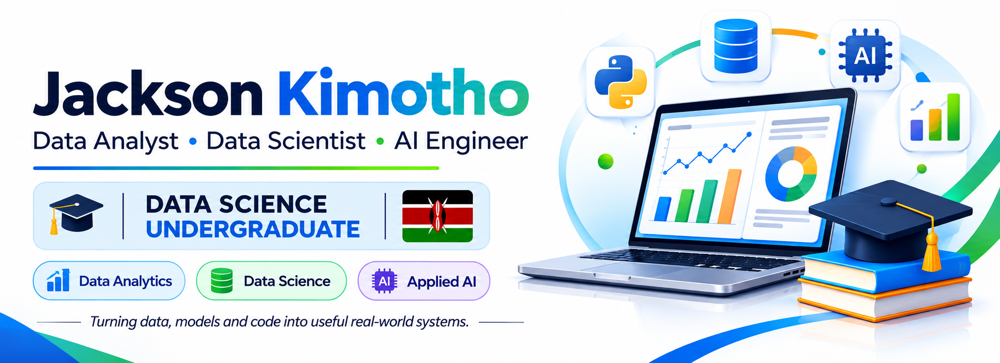
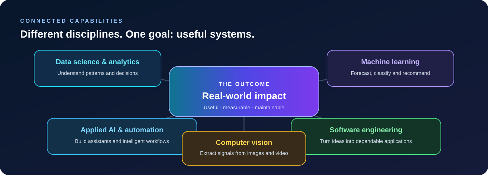
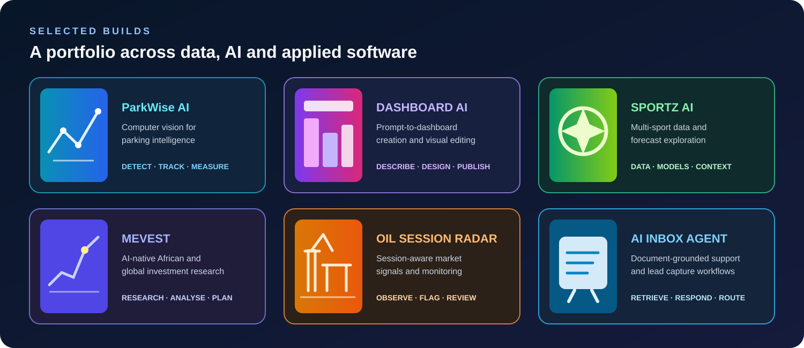
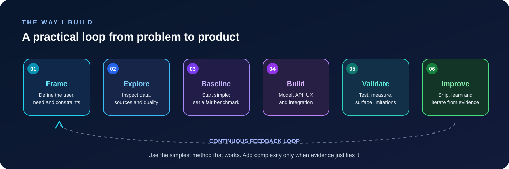
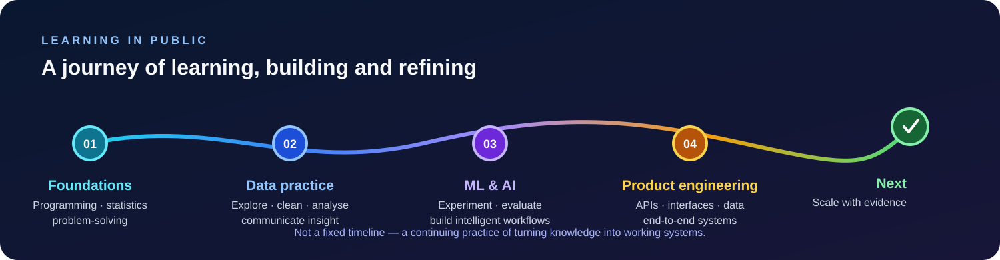
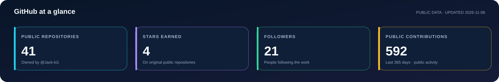
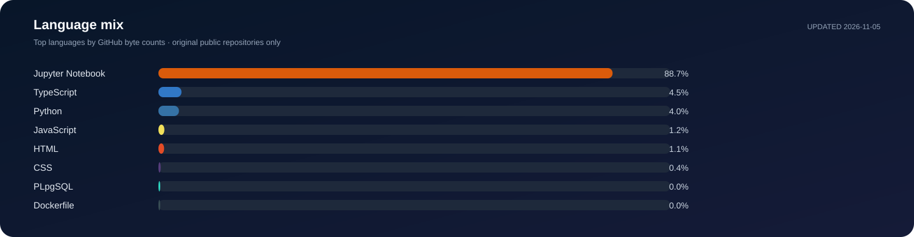
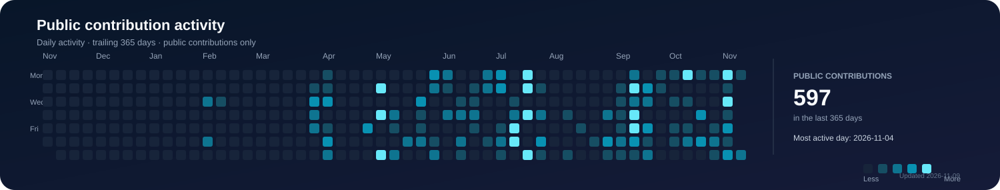

  
  
  

**I turn data, models and code into useful real-world systems.**

---

## Hello, I'm Jackson

I'm a data science and software practitioner based in Nairobi, Kenya, with a background in **Data Science at KCA University**. I work across **data analysis, applied machine learning, AI engineering and full-stack development**—usually where those disciplines meet a practical problem.

I enjoy the full build cycle: understanding the problem, exploring the data, testing a sensible baseline, building the model or workflow, and bringing it into an application people can use. I care about useful outcomes, clear evaluation and systems that are honest about their limitations.

  

## Selected work

I prefer projects that demonstrate a complete line from problem to working system. The graphic below is an illustrated overview; each project title links to its source repository for the implementation, setup and current scope.

  

| Project | What it explores | Main technologies |
|---|---|---|
| **[ParkWise AI](https://github.com/Jack-ki1/PARK_WISE_AI)** | Video-based vehicle detection and tracking, configurable parking-bay occupancy, and a dashboard backed by measured processing results. | Python, FastAPI, OpenCV, YOLO, Next.js |
| **[DASHBOARD AI](https://github.com/Jack-ki1/DASHBOARD_AI_01)** | AI-assisted dashboard creation from prompts, data or templates, with a visual editing studio and shareable dashboards. | React, TypeScript, Node.js, Express, SQLite |
| **[SPORTZ AI](https://github.com/Jack-ki1/SPORTZ_AI)** | Multi-sport data exploration and experimental forecasting with configurable statistical and AI-driven approaches. | JavaScript, Node.js, statistics, ML |
| **[MEVEST](https://github.com/Jack-ki1/MEVEST)** | An AI-native investment research and wealth-management experience with African-market context, portfolio analytics and cited AI insights. | React, TypeScript, Tailwind, Recharts, Supabase |
| **[Oil Session Radar](https://github.com/Jack-ki1/OIL-INSTITUTIONAL-DESK)** | Session-aware oil-market monitoring, volume anomaly analysis, news context and alert workflows; simulated order-flow elements are labelled as simulated. | Python, Flask, Pandas, SQLite |
| **[AI Customer Inbox Agent](https://github.com/Jack-ki1/AI-Customer-Inbox-Agent)** | A document-grounded support agent that retrieves from business knowledge, drafts replies, captures leads and supports configurable LLM and WhatsApp providers. | Python, FastAPI, TF-IDF, LLM APIs |

More experiments, learning projects and source code live in the [full public repository collection](https://github.com/Jack-ki1?tab=repositories).

## Selected product screens

A few real captures from running applications—not generic stock artwork. Open the project repositories for more screens and implementation detail.

  
  
  
  

## How I approach engineering

I don't start with the most complicated model or the newest framework. I start by understanding what needs to change, what evidence is available and how success will be evaluated.

  

A few principles guide that process:

- **Problem before technology.** Define the user, decision, constraints and expected outcome before choosing a stack.
- **Evidence before complexity.** Establish a baseline and use evaluation to justify more sophisticated methods.
- **End-to-end thinking.** A useful model needs reliable data, an API or workflow, a clear interface and sensible operations.
- **Transparency by design.** Distinguish live data from examples, model estimates from facts, and implemented features from roadmap ideas.
- **Iteration over theatre.** Test, learn from real use and improve the parts that matter.

## Learning & building journey

My development has been an ongoing progression from programming and statistical foundations into applied data work, machine learning, AI workflows and complete software products. The path below represents the areas I continue to build on—not a dated claim about when each skill was mastered.

  

## Technology toolkit

Tools I have used across coursework, experiments and product builds. The right tool depends on the problem; this is not a claim that every technology appears in every project.

**Languages & data**

**Machine learning & applied AI**

**Application development & infrastructure**

## GitHub activity

These charts are generated from GitHub's own API and stored in this repository. GitHub Actions refreshes them daily, so the README does not depend on third-party chart-rendering services.

  

  

  

Scope: public profile data and original public repositories. The contribution chart uses the contribution calendar visible to the workflow token; the language breakdown is calculated from GitHub language byte counts. Metrics refresh automatically each day; use the repository's Actions tab to run the workflow manually.

## What I'm exploring

I'm particularly interested in practical AI products, trustworthy data systems, computer vision, predictive analytics and tools that make complex information easier to act on. I also enjoy exploring how these technologies can solve problems in African markets and operating environments.

## Let's connect

Open to thoughtful conversations, technical collaboration and opportunities in **data science, AI/ML engineering and software development**.

- **LinkedIn:** [Jackson Kimotho](https://www.linkedin.com/in/jackson-kimotho1/)
- **Email:** [kimothojackson1125@gmail.com](mailto:kimothojackson1125@gmail.com)
- **GitHub:** [@Jack-ki1](https://github.com/Jack-ki1)

### Build with purpose. Measure what matters. Keep learning.

